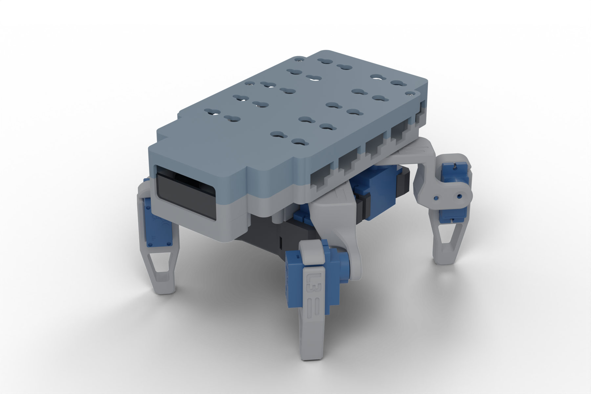
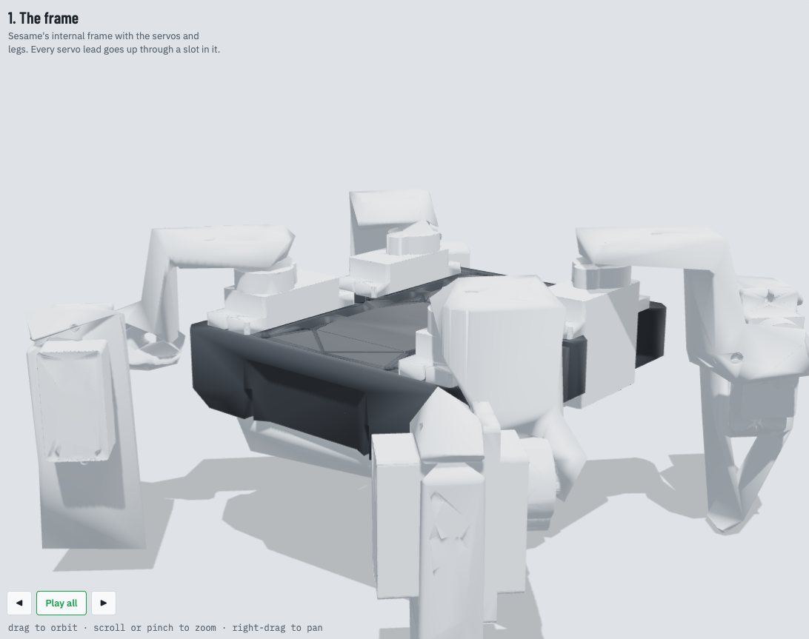
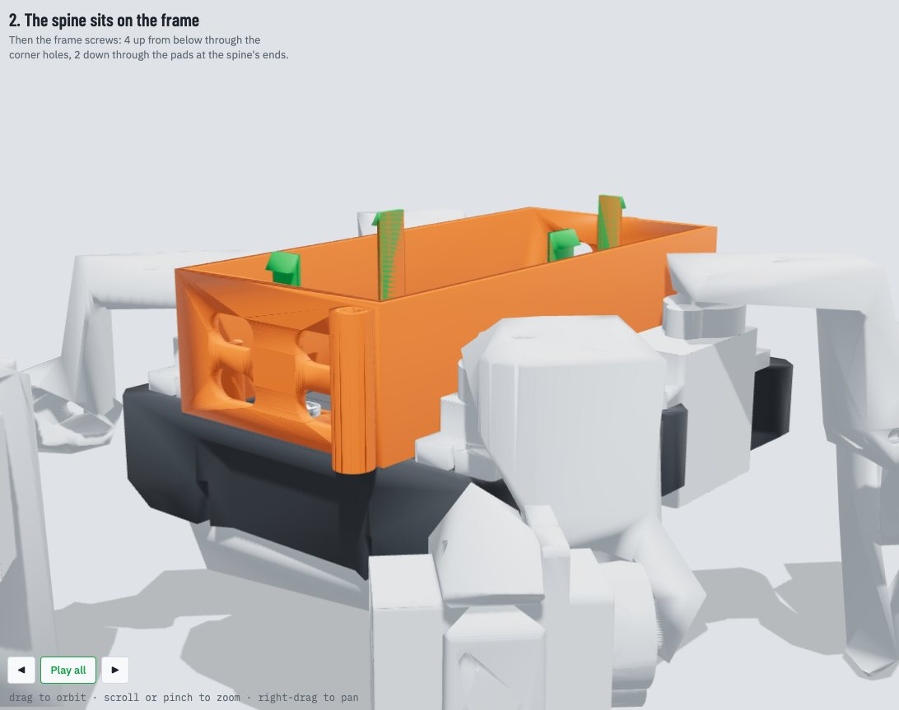
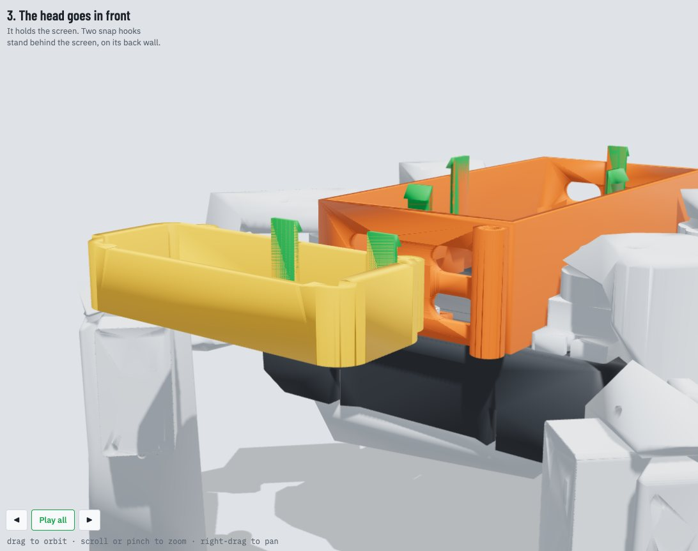
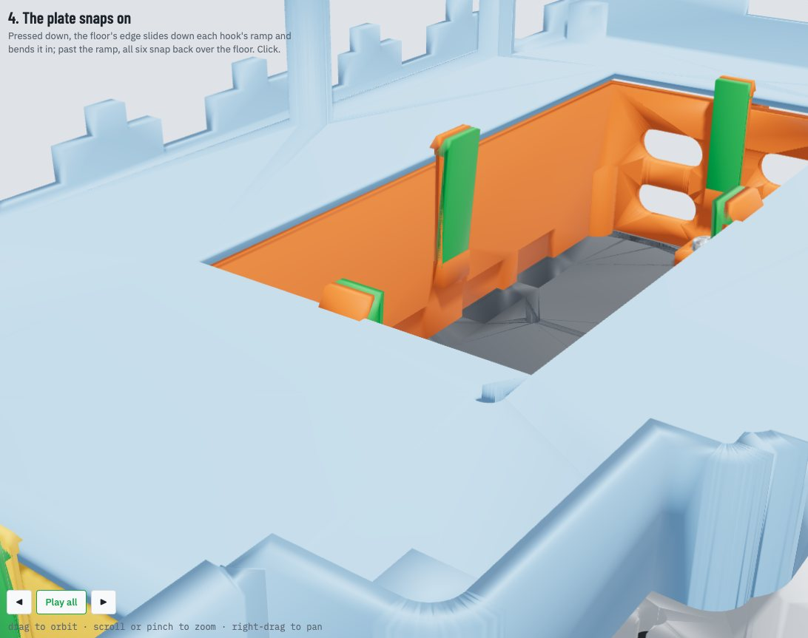
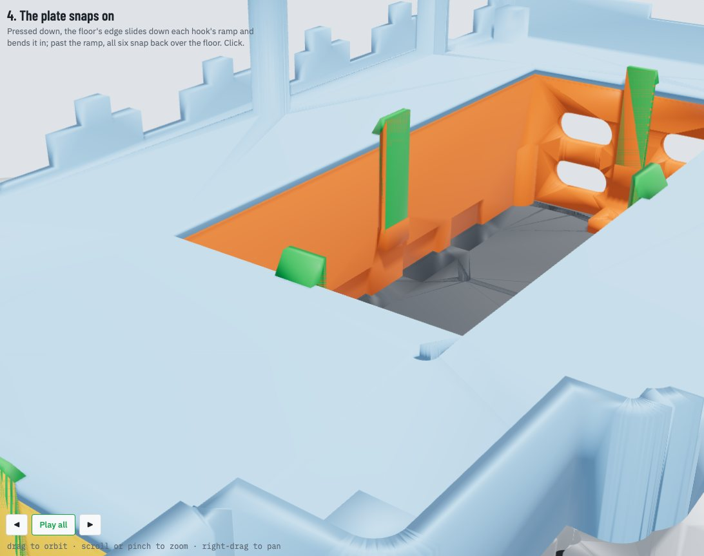
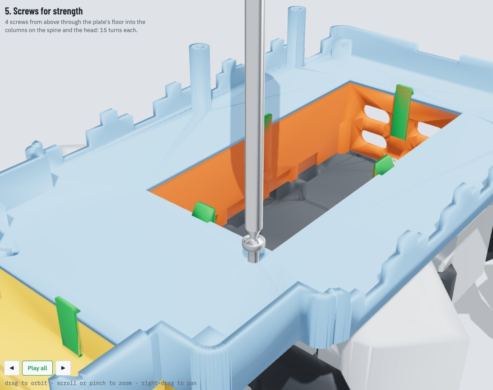
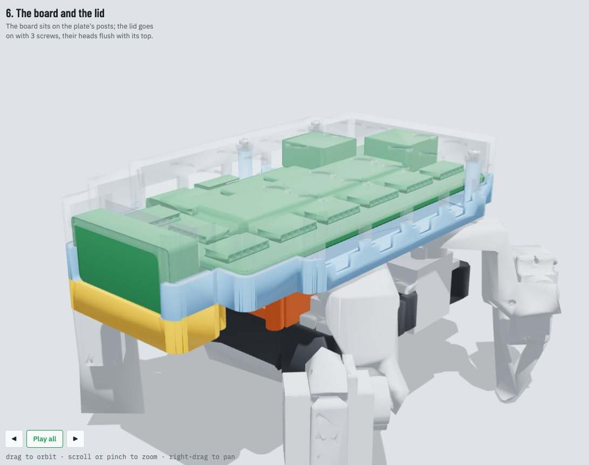

# Atech-crab



Atech-crab is [Sesame](https://github.com/dorianborian/sesame-robot), Dorian Todd's open-source quadruped: the same frame, servos, legs and moves, with an **Atech 14-port board** as its brain. The servos
plug straight into the board's ports on jumper wires, with no servo driver board. An Atech screen
in a visor at the front shows Sesame's face, and an Atech motion sensor keeps the walk on course.

Nothing under Sesame's top cover changes. The top cover is replaced by a **deck** that holds the board flat over
the legs and a **lid** that closes it. Both come from Atech Atelier's "Sesame walker".

**[Assembly tutorial](#assemble)** · [Animated 3D assembly](docs/assembly/index.html) (download, open in a browser) · [assembly guide (PDF)](docs/atech_crab_v6.3_assembly.pdf) · [assembly video (MP4, 50 s)](docs/atech_crab_v6.3_assembly.mp4) · [v6.3 overview (PDF)](docs/atech_crab_v6.3_overview.pdf)

## Status

| What | State |
|---|---|
| Firmware (`firmware/project.yaml`) | Builds with the Atech SDK and runs on the SDK's emulated board: all modules start, every move plays |
| Walking | Run in simulation (emulated board + MuJoCo): the motion sensor holds the walk within about 20° over ten cycles |
| Servo driver (`mg90s_pair`) | MG90S pulse range (500–2400 µs). Builds and runs on the emulated board; the earlier SG90 version drove an SG90 on a real 14-port board. **Not yet tried with MG90S on a board** |
| Deck, lid and frame (v6.3) | Pass Atech Atelier's fit check in CAD: the snap hooks, every screw's thread, the wire bobbins. **Not yet printed or assembled** |

Print and test-fit the deck on the frame, with the servos in, before you print more than one set.

## What changes from Sesame

| Sesame | Atech-crab |
|---|---|
| ESP32 + distro board (or PCA9685) | Atech 14-port board (ESP32-S3). Servos on ports 2, 3, 10 and 11, two per port |
| 128×64 OLED | Atech screen module, ports 13+14, in a front visor |
| — | Atech motion sensor (icm40608), port 4: heading hold while walking, 90° turns |
| USB on the ESP32 | Atech USB-C module, port 8, at the back |
| Top cover | Deck (three printed parts that snap together, plus screws) + lid |
| Arduino IDE | `pip install atech`, then `atech upload` |

The moves are Sesame's own. `firmware/make_firmware.py` reads them out of this repository's
[`firmware/movement-sequences.h`](../firmware/movement-sequences.h) and sends each servo the same angle
Sesame's firmware would, as an MG90S pulse: 0–180° → 500–2400 µs. (Sesame's own firmware uses 732–2929 µs,
which drives an MG90S into its end stop above about 137°.)

## Parts

**Printed (14):** Sesame's internal frame (with lead slots added), bottom cover, femurs L1 L2 R1 R2 and feet
L3 L4 R3 R4, plus deck part 1 (the plate), part 2a (the spine), part 2b (the head) and the lid. All 14 are in
[`print/stl/`](print/stl/), turned the right way up. **Wire parts (16)** in [`print/stl_wires/`](print/stl_wires/):
4 wire bobbins, 4 port jumper holders, 8 servo plug sleeves.

**Hardware:** 8 × MG90S servos (metal gear, 180°) · Atech 14-port board · Atech USB-C module · Atech motion sensor module ·
Atech screen module with its cable · male-to-male jumper wires · a 5 V 3 A supply for the servos.

**Screws, two kinds only:** **M2 × 6 mm pan-head self-tapping** (4.5 mm head) for the whole body, about 55 ·
**M2.5 × 5 mm machine screws** for the 8 servo horns (they thread into the servos' metal shafts).

## Print

**[3D printing guide](print/README.md)**: settings, every part and its orientation, and the wire openings.

Sliced and checked for Bambu Lab printers, PLA Basic, Textured PEI plate, 0.4 mm nozzle, 0.20 mm layers,
tree supports from the build plate only:

| Printer | File(s) in [`print/gcode/`](print/gcode/) | Time |
|---|---|---|
| H2S | `atech_crab_pla_h2s.gcode.3mf` | 4 h 35 min |
| H2D | `atech_crab_pla_h2d.gcode.3mf` | 4 h 46 min |
| X2D | `atech_crab_pla_x2d_plate1` + `_plate2` | 3 h 08 + 1 h 37 |
| P2S | `atech_crab_pla_p2s_plate1` + `_plate2` | 3 h 41 + 1 h 04 |

Other printers: slice the STLs yourself (the [guide](print/README.md) has the settings), or run
`print/slice.py` (it uses Bambu Studio's own printer profiles, so the start G-code is the printer's own)
and `print/check.py`.

## Assemble

Watch it first: the [animated 3D assembly](docs/assembly/index.html) plays every step below, with the hooks
clicking and the screws driven in (download it and open it in a browser; switch the screws off to see the
deck held by its hooks alone), or the [video](docs/atech_crab_v6.3_assembly.mp4). The [assembly guide (PDF)](docs/atech_crab_v6.3_assembly.pdf) has the same steps on paper, with the wiring.

You need: the 14 printed parts and the 16 wire parts, the hardware above, a PH0 screwdriver.

### 1. The base, and a slot for every lead

Build Sesame's base as in its [build guide](../docs/build-guide/README.md): the servos in the internal frame,
the legs on. Leave the bottom cover off. With the robot upside down, push each servo's plug up through **its own
slot** in the frame (one per servo, along the wire channels), then press the lead into the channel as Sesame's
guide does. The leads come out inside the spine.



### 2. The spine onto the frame

Set deck part 2a, the spine, on the frame. Screw it down with **4 screws up from below**, through the frame's
corner holes, and **2 screws down from above**, through the pads at the foot of the spine's end walls (reach them
through the opening, now, before anything goes on top). Then the battery, and the bottom cover (2 screws).



### 3. The head

Put the screen in deck part 2b, the head, face to the window, connector edge down, and set the head in front
of the spine. Its two snap hooks stand behind the screen, on its back wall.



### 4. The plate snaps on

Lower deck part 1, the plate, floor-down over the spine and the head, the servo leads up through its opening.
Press it down evenly: the edge of the floor slides down each hook's ramp and bends it inward…



…and all **six click** back over the floor's edge. The keys on the spine and the head fit the recesses under the
plate, so it only goes one way. It holds now, enough to try it. To take it off, push each hook inward from above.



### 5. Screws for strength

Drive **4 screws** down through the plate's floor into the columns on the spine and the head: front right and
back of the spine, left and right behind the head (front left of the spine has none: a screen ribbon lies there).



### 6. Board, wiring, lid and bobbins

1. The board on the four posts; the USB-C module on port 8, the motion sensor on port 4, the screen's cable
   to ports 13+14.
2. Wire the servos ([below](#wire)): put each port's three jumpers in a **port jumper holder** and plug the
   holder in; join each servo plug to its jumpers inside a **servo plug sleeve**.
3. The lid, with **3 screws**; their heads sink flush in its top.
4. Wind each leg's spare wire round a **wire bobbin**, pinch the ends in its slits, drop its two pegs into the
   keyholes by that port on the lid and slide it 4 mm outward to lock.



## Wire

| Port | Leg | Line A (pin 5) | Line B (pin 6) |
|---|---|---|---|
| 2 | front left | L1 hip | L3 knee |
| 3 | front right | R1 hip | R3 knee |
| 10 | back left | L2 hip | L4 knee |
| 11 | back right | R2 hip | R4 knee |

Each port is a 6-pin header: 1 +12 V, 2 +5 V, 3 +3.3 V, 4 GND, 5 line A, 6 line B. Run the signal and GND
jumpers out through the slot at each port. Both sides have slots and lead notches (ports 2–6 on the right,
10–14 on the left), so a lead can leave on either side. Power the servos from the 5 V supply (red to +, brown to −), and
join the supply's − to a port's GND.

> **+12 V sits next to +5 V, and which end of the header is pin 1 is not marked.** Measure before you wire:
> with the board on USB, the pin reading 3.3 V is pin 3, and its neighbour that beeps to the USB-C shell is GND
> (pin 4). Never connect pin 1 to a servo.


## Software

```bash
pip install atech
cd atech/firmware
atech validate .
atech upload .                 # builds and flashes over USB; the first build downloads the ESP32 compiler
atech check                    # which modules answered
```

About 2.5 s after it starts, the robot stands up and plays a show: wave, walk, turn left, walk, dance, crab,
turn right, push-ups, cute, bow, shake, stand. **Hold it off the table, or give it room, the first time.**

Play any move from the laptop:

```bash
atech send spider_go walk      # rest stand wave dance swim point pushup bow cute freaky
                               # worm shake shrug dead crab walk back left right
atech monitor                  # spider_move, and spider_state (roll, pitch, yaw, servo angles) 10 times a second
```

From Python:

```python
from atech import Board

with Board.connect() as board:
    board.call("spider_go", "wave")
    for event in board.events(keys=["spider_move"]):
        print("now playing", event.value)
```

`left` and `right` repeat until the motion sensor has counted 85° (six times at most), and `walk` steers by
the sensor's heading.

**New moves:** edit `firmware/movement-sequences.h` (by hand or with
[Sesame Studio](https://github.com/dorianborian/sesame-studio)), then

```bash
python atech/firmware/make_firmware.py   # writes atech/firmware/project.yaml
atech upload atech/firmware
```

To test without a robot: `atech emulate atech/firmware --seconds 10` runs the same firmware on an emulated board.

### Calibrate the servos, with the assembly guide at hand

One local page does both: run `./start` in `atech/port_test` (or `python3 control.py` there) and it opens
**http://localhost:8766**, the servo test and calibration page. Its **📖 Assembly guide** button opens the
animated 3D assembly at http://localhost:8766/assembly. The server holds the board's USB port, so close
`atech monitor` first.

## Files

```
atech/
├── port_test/
│   ├── start                   starts the calibration page at http://localhost:8766 (guide at /assembly)
│   ├── control.py, control.html  the servo test and calibration page and its server
│   └── calibration.json        the saved calibration (former ones in calibrations/)
├── firmware/
│   ├── project.yaml            the firmware: modules, ports, code (written by make_firmware.py)
│   ├── make_firmware.py        Sesame's movement-sequences.h -> project.yaml
│   └── my_modules/mg90s_pair/  two MG90S servos per port, 50 Hz LEDC (8 servos per board)
├── print/
│   ├── stl/                    all 14 parts, print orientation
│   ├── gcode/                  sliced for H2S, H2D, X2D, P2S (PLA)
│   ├── slice.py, check.py      re-slice with Bambu Studio's profiles; check a sliced file
│   └── README.md               the 3D printing guide
├── cad/
│   ├── sesame_atech_wired.py   the deck and lid (Atech Atelier, FreeCAD), with the wire openings
│   ├── cut_openings_left.py    the v4 left-side openings, cut into the print STLs
│   ├── cut_openings_back.py    the v5 openings at ports 6 and 14, cut into the print STLs
│   ├── export_print.py         v6.1+: the deck, lid and frame print STLs, straight from the model
│   ├── wire_parts.py           the wire bobbins, jumper holders and plug sleeves
│   ├── print_to_model.json     each print STL's place in the CAD frame
│   └── review.png
└── docs/
    ├── assembly/               the animated 3D assembly (index.html) and the tutorial's pictures
    ├── atech_crab_v6.3_assembly.pdf  the assembly guide
    ├── atech_crab_v6.3_assembly.mp4  the assembly video
    ├── atech_crab_v6.3_overview.pdf
    └── img/
```

## Licence and credits

Apache-2.0, like Sesame: see [`LICENSE`](../LICENSE) and [`NOTICE`](../NOTICE).


- **Sesame** by Dorian Todd ([dorianborian/sesame-robot](https://github.com/dorianborian/sesame-robot)),
  Apache-2.0: the frame, servos, legs and moves.
- **Deck and lid**: Atech Atelier's "Sesame walker" 0.1.3, with wire openings added on both sides (v4) and at ports 6 and 14 (v5).
- **Firmware**: built with the [Atech SDK](https://github.com/atechdotdev/python-sdk).
